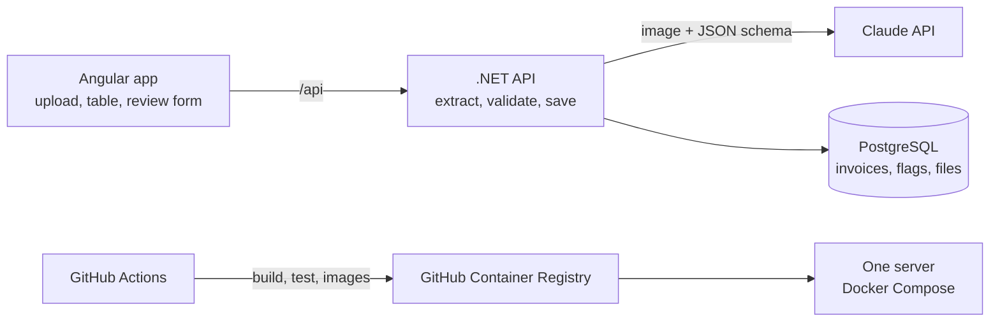

# GST Invoice Extractor

Upload an Indian GST invoice (photo or PDF). An LLM reads it into structured fields, deterministic rule checks flag anything that doesn't add up, and a reviewer fixes and approves it.

**Stack:** .NET 8 Web API · EF Core + PostgreSQL · Angular 20 · Claude (structured outputs) · xUnit · Docker Compose · GitHub Actions

> Screenshot / demo GIF: _add after your first real run (see "Before you put this on your resume")._

## Why this project is more than an "AI wrapper"

| Problem with LLM extraction | What this app does about it |
| --- | --- |
| The model can return malformed output | Structured outputs with a strict JSON schema, mapped to a typed C# record |
| The model can misread digits (O vs 0, 8 vs B) | GSTIN checksum, tax math, CGST/SGST vs IGST, totals, duplicate checks in plain C# |
| You can't trust what you don't measure | An eval harness scores field-level accuracy on labelled invoices |
| Provider lock-in | `IInvoiceExtractor` interface; a fake provider runs the whole app with no API key |

## Architecture



Request flow for an upload:

1. Angular posts the file to `POST /api/invoices`.
2. The API checks type and size, then `ClaudeInvoiceExtractor` sends it to the model with a JSON schema.
3. `InvoiceValidator` runs rule checks and returns flags (errors and warnings). The service adds a database duplicate check.
4. The invoice, its flags, token counts and latency are saved. Status is `NeedsReview`.
5. The reviewer corrects fields (re-validated on every save) and can approve only when no error flags remain.

## Run it

### With Docker (everything)

```bash
cp .env.example .env          # set EXTRACTION_PROVIDER=Claude and ANTHROPIC_API_KEY for real extraction
docker compose up --build
```

Open http://localhost:8080. With `EXTRACTION_PROVIDER=Fake` every upload returns the same sample invoice, so you can try the app with no key.

### Local development

```bash
# 1. Postgres
docker compose up db -d       # or any local Postgres matching appsettings.json

# 2. API on http://localhost:5080 (Swagger at /swagger)
cd backend
export Extraction__Provider=Claude ANTHROPIC_API_KEY=sk-ant-...   # optional; Fake is the default
dotnet run --project src/GstInvoice.Api

# 3. Angular on http://localhost:4200 (proxies /api to the API)
cd frontend && npm install && npx ng serve
```

### Tests and eval

```bash
cd backend
dotnet test                                                  # 30 unit tests, no API key needed
dotnet run --project src/GstInvoice.Eval -- --fake           # checks the eval harness itself
dotnet run --project src/GstInvoice.Eval -- --out eval-results.md   # real run, needs ANTHROPIC_API_KEY
```

## Eval results

`eval-data/synthetic/` holds 10 generated invoices with known values (some blurred or rotated), made by `tools/make_synthetic_invoices.py`. Add your own real bills as `name.jpg` + `name.json` pairs in `eval-data/real/` (mask personal details first).

| Metric | Result |
| --- | --- |
| Field accuracy | _run the eval and fill in_ |
| Invoices fully correct | _fill in_ |
| Median latency per invoice | _fill in_ |
| Tokens per invoice | _fill in_ |

## Project structure

```
backend/
  src/GstInvoice.Core/        Domain: extraction (Claude + fake), validation rules, eval comparer. No web or DB code.
  src/GstInvoice.Api/         ASP.NET Core API: controller, service, EF Core DbContext + migrations
  src/GstInvoice.Eval/        Console app that scores extraction accuracy
  tests/GstInvoice.Tests/     xUnit tests for validation, comparer and service
frontend/                     Angular 20 standalone components, signals, reactive forms
eval-data/                    Labelled invoices for the eval
tools/                        Synthetic invoice generator
.github/workflows/            CI (build, test, images), manual eval, manual deploy
docs/                         Deploy guide, study guide
```

## Design decisions and trade-offs

- **Synchronous extraction.** The API waits for the model (a few seconds). Fine for one invoice at a time. At volume this becomes a queue (SQS) plus a worker, with retries and idempotency keys.
- **Files in Postgres.** Kept in a separate `invoice_files` table so list queries never load bytes. In production they would go to S3 with only the key in the database.
- **Flags as jsonb.** Flags are always read with their invoice and never queried alone, so a JSON column is simpler than a child table.
- **Validation is pure C#, separate from extraction.** Easy to unit test, provider-independent, and cheap.
- **No auth.** It's a single-user demo. Multi-tenant auth is the first thing a real version needs.

## What I'd add next

1. RAG over GST circulars with cited answers (pgvector).
2. GSTR-2B reconciliation: match approved invoices against the portal's 2B JSON.
3. Queue-based extraction (SQS + worker), Terraform for the AWS setup, OpenTelemetry tracing.
4. Line items and HSN codes.

## Before you put this on your resume

1. Run the real eval and fill in the results table above.
2. Run the app with `EXTRACTION_PROVIDER=Claude`, upload a few bills, and add a screenshot or GIF.
3. Deploy it (see [docs/DEPLOY.md](docs/DEPLOY.md)) and add the live link.
4. Work through [docs/STUDY_GUIDE.md](docs/STUDY_GUIDE.md) until you can explain every file.
